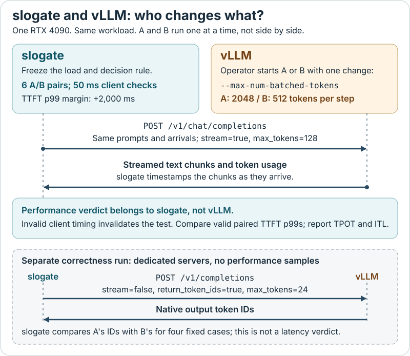

# slogate

**An SLO regression gate for LLM inference engines.**

slogate replays a fixed workload before a serving change ships. It checks whether the
client delivered the intended load, then compares baseline and candidate latency against
a margin chosen before the trial. Locating a regression in a specific runtime layer is
still a separate, unvalidated step.

> **Status: week 3 paired-gate MVP.** With the revised client, all six untraced
> RTX 4090 A/A runs passed the unchanged load-fidelity checks (4,722/4,722 requests
> succeeded). Read the **[weeks 1-2 report](docs/weeks-01-02.md)** for the failed first
> attempt, the client fix and what the [six measured GPU runs](docs/results/e0-2026-11-23.csv)
> actually show. The first [real vLLM A/B](docs/paired-gate.md#first-real-trial-small-budget)
> is now measured; the eager and small-graph trials, held-out calibration and GPU trace
> validation are still pending.

## How slogate talks to vLLM

The operator starts **either A or B**, one vLLM server at a time on the same RTX 4090.
slogate sends requests, times the responses and scores the comparison. It does **not**
set the scheduler budget through an HTTP request or patch vLLM's source code.

[](docs/figures/slogate-vllm.svg)

| Where the value is set | What we set in the measured trial |
|---|---|
| **vLLM at startup: changed** | `--max-num-batched-tokens`: **2048 (A) vs 512 (B)**. This is the only launch flag that differed between performance arms. |
| **vLLM at startup: unchanged** | `--max-num-seqs 32` (sequences per step), `--max-model-len 8192` (context), `--tensor-parallel-size 1` and `--no-enable-prefix-caching`. |
| **slogate sends in each performance request** | `max_tokens=128` caps **one answer**; `stream=true` asks for chunks as the answer is generated. Neither sets the shared scheduler budget. |
| **slogate only: never sent to vLLM** | Six A/B pairs; 50 ms checks on the **client** (launch lag, event-loop lag, GC pauses); **+2,000 ms** allowed TTFT p99 increase for the **relative** verdict. TPOT and ITL are reported, not used to pass the gate. |

See the [actual launch flags](configs/sut/vllm-0.30.0_qwen3-4b-instruct-2507_rtx4090.json)
and [A/B config generator](scripts/week3_candidates.py). `--enforce-eager` and smaller
CUDA graph capture sizes (`--compilation-config`) are **separate, unmeasured** vLLM
candidates. The [output check](docs/correctness.md#native-vllm-collection-for-the-small-budget-trial)
uses dedicated servers with `VLLM_BATCH_INVARIANT=1`, BF16 and `FLASH_ATTN` on **both**
arms; its timings never enter the performance gate.

## One GPU decision: 2048 vs 512 tokens per step

`--max-num-batched-tokens` is vLLM's **shared token budget for one scheduler step**:
processing a new prompt (*prefill*) and generating the next token for ongoing requests
(*decode*) draw from that budget. A allowed **2,048** tokens per step; B allowed **512**.
Neither number is a request count or an answer-length limit. A long prompt can span
steps; B does not truncate it at 512. Both arms kept the same 32-sequence limit per
step, 8,192-token context limit and 128-token output cap per performance request.

| Client metric (median of six run-level p99s per arm) | A: 2048 | B: 512 |
|---|---:|---:|
| Wait for the first token (TTFT) | 115.46 s | 116.49 s |
| Average time per subsequent token in a response (TPOT) | 53.34 ms | 50.63 ms |
| Individual visible token gaps (ITL) | 152.45 ms | 58.82 ms |

**Decision: pass the relative TTFT check.** B's p99 wait for the first token was
longer in all six pairs. The median **within-pair** increase was **1.04 s**;
the interval **[+0.96, +1.21] s** stayed below the **+2 s** margin fixed before the trial.
This is not an absolute latency target. Streaming gaps shortened, and a separate
four-case exact-output check passed.
[How the budget is shared, and what the experiment does not prove](docs/paired-gate.md#first-real-trial-small-budget)
| [Six measured pairs (CSV)](docs/results/small-budget-2026-11-25.csv)

## Why

Two p99 values can differ even when the engine has not changed. Before acting on a
benchmark, measure that variation and check whether the client actually delivered the
scheduled load. If the client stalls, keep the run as evidence but do not blame the engine.

## What works today

- **Paired comparison.** Freeze one candidate change and a practical margin before collecting
  interleaved A/B runs. Report relative performance, any configured absolute p99 ceiling,
  invalid measurements and insufficient evidence separately.
- **[Output correctness](docs/correctness.md).** Check separate token-ID evidence for
  scheduler changes, or compare same-prefix logprobs and a fixed-answer eval. Missing
  evidence is unverified; these checks are not implied by a performance pass.
- **Open-loop replay.** Every request launches on its scheduled arrival time and never waits
  for earlier responses, so a slow server shows up as latency instead of as reduced load.
- **Per-token timelines.** TTFT, per-token inter-token latency (multi-token chunks are split
  evenly), TPOT, end-to-end latency, and reconciliation against server-reported token usage.
- **Load fidelity.** Client launch lag, client event-loop lag and client GC pauses are
  measured on every run. A run that breaks them is reported as invalid measurement, never as
  a server regression.
- **A/A noise floor.** Repeated runs of an unchanged build give per-metric variation, drift
  and the minimum detectable effect (MDE) for a given number of paired runs.
- **Fake engine.** A CPU-only, OpenAI-compatible streaming server with injectable latency
  regressions, so CI exercises the gate without a GPU.
- **Versioned workloads.** Content-hashed workload files, a synthetic generator, and an
  importer for traces derived from the Azure LLM Inference Dataset 2024.

## Quickstart (CPU only)

```bash
python -m venv .venv && . .venv/bin/activate
pip install -e ".[dev]"

slogate fake-engine --port 8000 &
slogate workload synth --name smoke --duration-s 20 --rate-rps 8 --out workloads/smoke.json
slogate aa --base-url http://127.0.0.1:8000 --workload workloads/smoke.json \
  --runs 6 --cooldown-s 2 --out runs/aa-smoke
```

`runs/aa-smoke/noise.md` reports the run-to-run variation of each metric and the smallest
regression a paired comparison could detect. Each `run-NNN/` folder holds `run.json`
(metadata, fidelity verdict, metrics) and `records.json.gz` (every request's timeline), so
metrics can be recomputed without rerunning.

For the week 3 gate, this one command collects and scores four local controls: unchanged
A/A, deliberately slow B, underpowered B, and a mislabeled endpoint. Use a fresh directory:

```bash
python scripts/paired_demo.py --out runs/week3-controls
```

Read `scorecard.json` first, then each `gate.md` for its interval and per-pair deltas.
The 10 ms margin applies to these fake-engine examples only, not to the GPU baseline.

| CPU control (2026-11-23) | Paired TTFT p99 effect, B minus A | Observed performance verdict |
|---|---:|---|
| Same fake build, 6 pairs | interval: -2.65 to +3.94 ms | Pass |
| Add 60 ms to the fake first-token setting, 6 pairs | interval: +37.48 to +44.66 ms | Fail |
| Same delayed setting, only 2 pairs | no finite 95% interval | Inconclusive |
| Label the unchanged endpoint as the delayed candidate | wrong identity, interval not evaluated | Invalid measurement |

All 750 measured requests returned successfully. These [CPU controls](docs/results/week3-cpu-pairs-2026-11-23.csv)
exercise the verdicts; they do not measure vLLM performance or a production false-alarm rate.

For the separate [correctness controls](docs/correctness.md), run
`python scripts/correctness_demo.py --out runs/correctness-demo`. The examples include a
changed token, numerical drift with an unchanged answer, a lost answer with unchanged
scores, and a missing score. No model is invoked.

## Against vLLM on a GPU

`configs/sut/` pins a system under test (engine version, model revision, serve flags), and
`scripts/gpu/run_aa.sh` runs an A/A measurement on a single-GPU host with a wall-clock cost
cap. See [scripts/gpu/README.md](scripts/gpu/README.md).

Keep worker tracing **off** for E0. A separate `SLOGATE_TRACE=1` run records scheduled work,
observed graph mode and current-stream CUDA events for each supported worker. These
instrumented measurements are diagnostics, not SLO samples.

## Exit codes

| Code | Meaning |
|---:|---|
| 0 | `run`: client fidelity passed. `aa`/`noise`: at least three valid runs with no failed requests; check `excluded_runs` for the rest |
| 1 | Usage or input error |
| 3 | Invalid measurement: load fidelity failed, or fewer than three healthy A/A runs |

For `ab report`, exits are **0** performance pass, **2** performance/SLO failure, **3**
invalid measurement, **4** inconclusive, and **1** input error. See the [paired evidence
contract](docs/paired-gate.md) before using the result in CI.

## Development

```bash
pip install -e ".[dev]"
ruff check src tests scripts && ruff format --check src tests scripts
pytest
```

CI runs the same checks on Linux for every push and pull request. Tests use the fake engine
and never need a GPU or network access beyond localhost.

### CPU diagnostic: client pressure

To investigate the 4090 E0 fidelity failures without renting a GPU, run the following in a
Linux checkout with the fake-engine dependencies and the [pinned workload](workloads/README.md).
Choose a new output directory each time:

```bash
PYTHONPATH=src python scripts/cpu_pressure.py --out runs/client-pressure
PYTHONPATH=src python -m slogate.pressure_report runs/client-pressure
```

Six loopback trials keep the arrival schedule and token counts fixed. Only the fake first-token
delay changes (A: 50 ms; B: 23.5 s), to target roughly 650 outstanding requests in B. Each
trial starts fresh server/client processes, leaves automatic GC enabled and keeps the normal
50 ms fidelity limits. `--client-timing` adds wakeup deadlines/lags and GC spans to the replay
diagnostics on one monotonic clock; it is **off by default** for normal SLO runs. The report
includes invalid trials and measures GC overlap only after a wakeup deadline, not during the
intended sleep. Temporal overlap is evidence for investigation, not attribution of all delay.

For a closer CPU diagnostic, supply the six **local** E0 run directories under `SOURCE_AA`.
The fake server joins each request to its saved stream by workload ID and unique prompt/cap,
then emits filler SSE content on absolute deadlines relative to that request's arrival. It
reuses the same schedule for warmup without consuming the measured request. Headers, visible
chunk widths/times and completion times are from client records, not an engine trace. Raw
SSE control events, text, GPU work and unobserved token times are not reconstructed.

```bash
PYTHONPATH=src python scripts/cpu_pressure.py --recorded-aa "$SOURCE_AA" --out "$OUT"
PYTHONPATH=src python -m slogate.timeline_report "$OUT" "$SOURCE_AA"
```

`timeline.md` reports two independent checks: how closely the local timestamps matched, and
whether the replay client passed the normal 50 ms fidelity checks. `timeline.json` retains
per-source SHA-256, paired timing errors, request-seconds, GC overlap and failure reasons.
To test cross-request alignment, add `--shared-clock` to `cpu_pressure.py` and choose a new output
directory. Measured clients pass their same-host monotonic replay epoch to the loopback fixture;
the server targets the original absolute offsets instead of starting each schedule when its HTTP
request arrives. Warmups still run on their own clocks. Both modes use the same predeclared timing
checks, and neither changes ordinary vLLM requests. Never use synthetic timings as SUT SLO samples.

### Qualifying a streaming client change

The measured path uses aiohttp; readiness probes and warmup use HTTPX. Normal runs record the
measured transport/version in `run.json` and leave Python's GC policy unchanged.

To investigate live objects around the reproduced stall, run the allocation profiler against
local source `run-001`. Its snapshot pauses the process; discard **all** profiled timings:

```bash
PYTHONPATH=src python scripts/profile_client_heap.py \
  --source "$SOURCE_AA/run-001" --out "$OUT/heap"
```

For the actual comparison, use the same Linux environment and harness for both arms. Set
`BASELINE_SRC` to a frozen copy of the previous client's `src` directory with shared-clock
support. Run the two commands **serially**, with new output directories. Exit `3` is a
retained qualification failure, not a reason to discard that arm.

```bash
export PYTHONHASHSEED=1
python -B scripts/sustained_replay.py --source "$SOURCE_AA/run-001" \
  --waves 3 --client-src "$BASELINE_SRC" --out "$OUT/before"
python -B scripts/sustained_replay.py --source "$SOURCE_AA/run-001" \
  --waves 3 --client-src ./src --out "$OUT/after"
```

Each arm keeps one client PID across all waves, with no allocation profiler or detailed timing
trace. `report.json` records timing fit, fidelity, stream/usage checks and external RSS samples.
See the [measured results and remaining failure](docs/design.md#normal-gc-streaming-client).

## Data

Traces imported with `slogate workload import-lab` derive from the
[Azure LLM Inference Dataset 2024](https://github.com/Azure/AzurePublicDataset/blob/master/AzureLLMInferenceDataset2024.md),
licensed under CC-BY 4.0. Please cite: Stojkovic et al., *DynamoLLM: Designing LLM Inference
Clusters for Performance and Energy Efficiency*, HPCA 2025. Prompt text is synthetic; only
arrival times and token counts come from the trace.

## License

Apache License 2.0.
